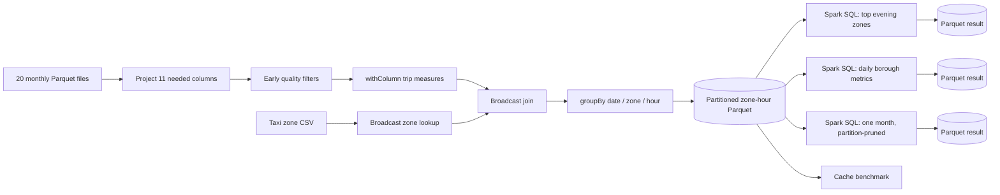
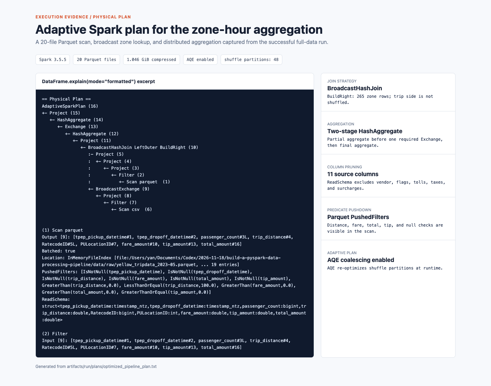
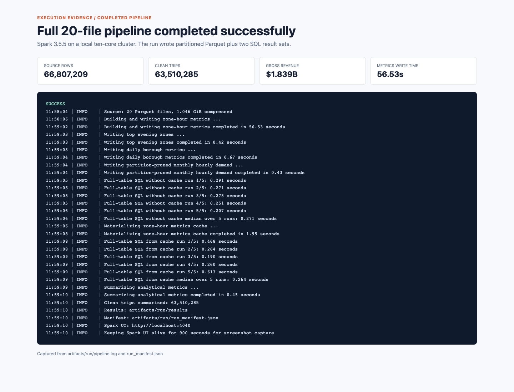
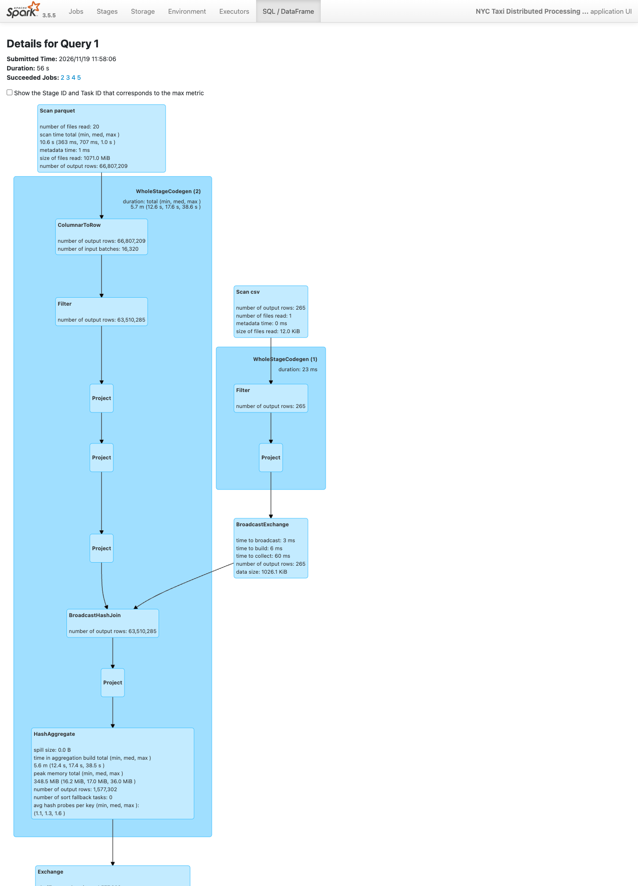
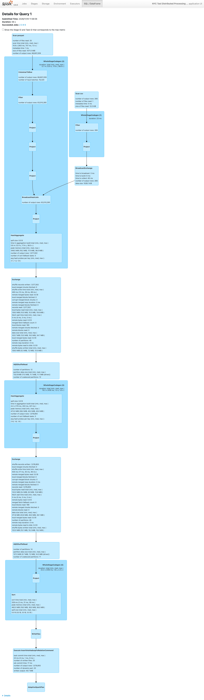
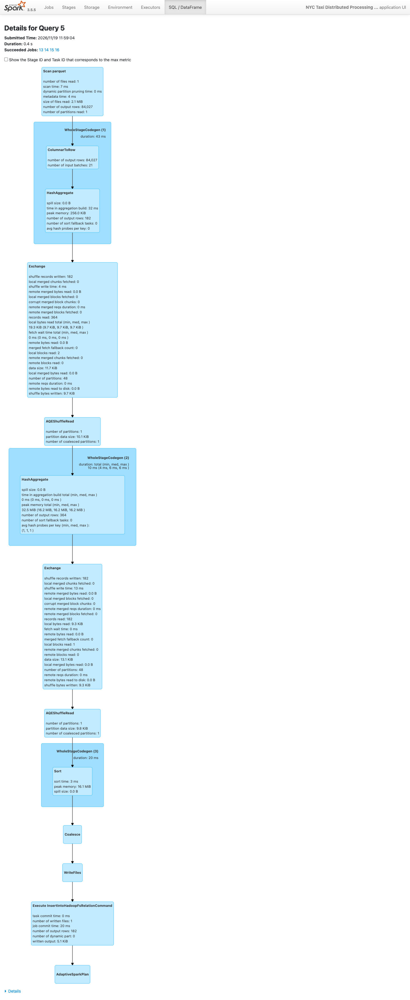

# NYC Taxi PySpark Processing Pipeline

A reproducible PySpark pipeline over 20 months of New York City yellow-taxi
records. The project demonstrates partitioned Parquet reads, early filtering,
column pruning, a broadcast join, distributed aggregation, Spark SQL, query
plans, caching, and the difference between lazy transformations and eager
actions.

## Dataset

**Source:** [NYC TLC Trip Record Data](https://www.nyc.gov/site/tlc/about/tlc-trip-record-data.page)

| Asset | Source |
|---|---|
| Yellow taxi trips, May 2023 through December 2024 | `https://d37ci6vzurychx.cloudfront.net/trip-data/yellow_tripdata_YYYY-MM.parquet` |
| Taxi zone lookup, 265 zones | `https://d37ci6vzurychx.cloudfront.net/misc/taxi_zone_lookup.csv` |

The 20 monthly Parquet files occupy **1.046 GiB (1.123 GB) compressed** and
contain **66,807,209 source records**. The compressed material is already
larger than 1 GB; decoded columns and Spark's working representation are
several times larger. Source files are intentionally not committed. The
download script verifies HTTP content lengths and skips files that already
exist.

The trip data contains pickup/dropoff timestamps, distance, passengers, fare,
tip, total amount, payment type, rate code, and pickup/dropoff zone IDs. The
zone lookup maps location IDs to borough, zone name, and service zone.

## Pipeline Architecture



The key design decision is to materialize the trip-to-zone/hour aggregate once,
then run both SQL analyses against that compact data product. Recomputing the
join and scan independently for every report would perform unnecessary work on
the raw source.

## Processing Steps

1. **Schema-pruned read:** selects 11 analytical columns instead of materializing
   every source field.
2. **Multiple early filters:** restricts pickup time to the study range, checks
   timestamp ordering, distance, fare/total/tip amounts, passenger count, and
   trip duration before the join and aggregation.
3. **`withColumn` measures:** derives pickup date/month/weekday/hour, duration,
   speed, and an airport-trip indicator.
4. **Broadcast join:** joins the small taxi-zone lookup without shuffling the
   large trip side.
5. **Distributed `groupBy`:** aggregates trips by date, weekday, hour, borough,
   and zone. Metrics include trips, revenue, tips, distance, duration, speed,
   and airport trips.
6. **Partitioned write:** writes the intermediate Parquet table partitioned by
   `pickup_month`. Repartitioning by month avoids thousands of tiny files and
   produced one Parquet file in each of the 20 monthly directories.
7. **Spark SQL:** computes the top 20 evening pickup zones, daily borough
   metrics, and hourly demand for one month (July 2024). The monthly query
   filters on the `pickup_month` partition column, so Spark reads only one of
   the 20 partition directories.
8. **Cache comparison:** runs the same SQL action several times before and
   after caching the compact zone-hour table and reports the median.

## Repository Layout

```text
.
|-- src/taxi_pipeline/
|   |-- analytics.py         # the two Spark SQL queries
|   |-- io.py                # source readers and file metadata
|   |-- pipeline.py          # orchestration, plans, timings, outputs
|   |-- spark_session.py     # AQE and Parquet configuration
|   `-- transform.py         # lazy DataFrame transformations
|-- scripts/
|   |-- actions_vs_transformations.py
|   `-- download_data.py
|-- tests/test_transformations.py
|-- scripts/render_docs.py   # renders plan/log summary images
|-- docs/images/             # screenshots used in this README
|-- outputs/execution_evidence/  # committed plans, logs, manifest, CSVs
|-- artifacts/run/           # local run output (git-ignored)
`-- Makefile
```

## Run It

Prerequisites are Python 3.9+ and Java 17.

```bash
brew install openjdk@17
make setup
make download
make run
```

The equivalent explicit commands are:

```bash
export JAVA_HOME="$(brew --prefix openjdk@17)/libexec/openjdk.jdk/Contents/Home"
export PYTHONPATH=src
python scripts/download_data.py
python -m taxi_pipeline.pipeline
```

The run displays Spark's UI URL and writes:

- `artifacts/run/results/zone_hour_metrics.parquet`
- `artifacts/run/results/top_evening_zones.parquet`
- `artifacts/run/results/daily_borough_metrics.parquet`
- `artifacts/run/results/monthly_hourly_demand.parquet`
- `artifacts/run/plans/*.txt`
- `artifacts/run/pipeline.log`
- `artifacts/run/run_manifest.json`

To inspect the live Spark UI after completion:

```bash
python -m taxi_pipeline.pipeline --ui-pause-seconds 300
```

For a quick functional check without downloading the full dataset, download
one month and run with a sample:

```bash
python scripts/download_data.py --start-month 2024-01 --end-month 2024-01
python -m taxi_pipeline.pipeline \
  --input-glob 'data/raw/yellow_tripdata_2024-01.parquet' \
  --sample-fraction 0.05 \
  --output-dir artifacts/smoke
```

## Execution Evidence

`artifacts/run/` is git-ignored, so a copy of the run's plans, logs, manifest,
and SQL results is committed under `outputs/execution_evidence/`.
The screenshots and committed evidence in this repository all come from the
run recorded at `2026-11-19T16:58:04Z` in
`outputs/execution_evidence/run_manifest.json`.

### Physical and optimized plans

The formatted physical plan is generated by
`DataFrame.explain(mode="formatted")`; the committed copies are in
`outputs/execution_evidence/plans/`.







The Query Details graph above is the 56-second zone-hour write. Its Parquet
scan reports 66,807,209 output rows, followed by `Filter`,
`BroadcastHashJoin`, `HashAggregate`, `Exchange`, and `WriteFiles`.

The full-page capture below includes the expanded physical-plan details:



The monthly SQL plan
(`outputs/execution_evidence/plans/monthly_partition_pruning_plan.txt`) shows
`PartitionFilters: [isnotnull(pickup_month), (pickup_month = 2024-07)]`,
which is partition pruning: only the `pickup_month=2024-07` directory is read.



The monthly query's Query Details view reports one file read, one partition
read, and 84,027 output rows.

The source-scan plan shows only the 11 selected columns in `ReadSchema`, and
the Parquet scan exposes the applicable filters in `PushedFilters`. The
optimized plan contains a `BroadcastHashJoin` for the zone lookup, a
distributed `HashAggregate`, and an `Exchange` caused by the required
`groupBy`.

## Performance Analysis

**How Spark optimized the query.** Spark first reduced the scan to the
analytical columns, so Parquet only decoded the required column chunks. The
timestamp, distance, amount, passenger, and duration filters were placed before
the broadcast join; the narrowed `ReadSchema` shows the column pruning. The
Parquet scan pushed the null checks and the distance, fare, total, and tip
predicates into `PushedFilters`. The timestamp range is evaluated immediately
after the scan because the source type is cast before comparison, which is one
remaining pushdown limitation. Because the zone lookup is tiny, the broadcast
hint produced a `BroadcastHashJoin` and avoided shuffling the multi-million-row
trip side. Adaptive Query Execution then coalesced the post-shuffle partitions
and used the adaptive physical plan for the aggregation.

**Bottlenecks.** The expensive boundary is the group-by: all trips must be
redistributed by date, zone, and hour, so Spark introduces an `Exchange`.
Parquet's file/row-group layout cannot prune files by pickup date because the
source is not partitioned on that field; predicate pushdown can reject values
inside row groups but still requires reading the metadata and candidate data.
Casting the timestamp columns also prevents the range predicate itself from
being pushed down. Partitioning the intermediate by `pickup_month` fixes this
for downstream queries: the monthly SQL report prunes 19 of the 20 partition
directories before reading any data. The second avoidable bottleneck would
have been rereading and rejoining the 20 raw files for each SQL report. Writing the
1,576,855-row zone-hour intermediate and querying it multiple times removes that
repeated work. The final write also adds a deliberate shuffle so the 20
monthly output directories are reasonably sized.

**Optimizations applied.** The implementation prunes columns at read time,
filters before enrichment and aggregation, broadcasts the lookup, lets AQE
coalesce shuffle partitions, and partitions the analytical table by month. It
uses `coalesce(1)` only for the few-row report outputs; that operation is safe
there because it is not used on the large intermediate. The cache benchmark
uses `MEMORY_AND_DISK` for the compact zone-hour table, so repeated SQL actions
reuse decoded rows rather than rescanning Parquet.

### Cache benchmark

Each side runs the same SQL action 5 times after one untimed warm-up; the
table reports the median (all runs are in `run_manifest.json` under
`cache_benchmark`).

| Measurement | Seconds |
|---|---:|
| Full-table SQL aggregation, no cache (median of 5) | 0.271 |
| Materialize `MEMORY_AND_DISK` cache (once) | 1.947 |
| Same aggregation from cache (median of 5) | 0.264 |

The warmed median improved by only 0.007 seconds, about 2.6%, which is within
normal run-to-run variation for this small intermediate. Parquet decoding is
already fast, the operating-system page cache is warm after the untimed
warm-up, and the cached run includes in-memory scan overhead. The one-off
1.947-second materialization cost therefore makes caching a net loss for this
query pattern. The cache is intentionally applied to the aggregate,
not to all 66.8 million raw trips, which would place unnecessary pressure on a
single local driver.

## Key Findings

The full-run manifest contains the machine-readable values. The leading
evening pickup zones by gross revenue were:

| Rank | Pickup zone | Trips | Gross revenue |
|---:|---|---:|---:|
| 1 | JFK Airport | 821,195 | $70,117,771.23 |
| 2 | LaGuardia Airport | 530,513 | $35,859,493.37 |
| 3 | Midtown Center | 942,965 | $23,389,389.95 |

These values come from `outputs/execution_evidence/run_manifest.json`; the
committed screenshots, plans, and manifest are from one execution of the
default 20-file input.

Other observations:

- Manhattan accounts for 56.4 million of the 63.5 million clean trips and
  $1.36 billion of the $1.84 billion gross revenue.
- Queens has far fewer trips, but its airport-heavy mix produces $73.65
  revenue per trip versus $24.14 in Manhattan.
- Thursday was the busiest weekday in the daily output, while Saturday had
  the highest weekend trip count.

## Transformations vs Actions

Run the standalone demonstration:

```bash
make demo
```

`scripts/actions_vs_transformations.py` records the Spark job count before and
after a `withColumn -> filter -> select` chain. The count remains zero because
those operations only extend the logical plan. Calling `take(5)` materializes
the plan, launches a Spark job, and returns rows. The log also contains the
physical plan printed by `explain()` before the action, and shows that
`explain()` itself launches no job. The committed log is
`outputs/execution_evidence/actions_vs_transformations.log`.

## Output Destinations

- **Analytical intermediate:** partitioned Parquet, one directory per month.
- **SQL reports:** coalesced Parquet files for easy review.
- **Run metadata:** JSON manifest with source size, row totals, timings, and
  top-zone results.

## Tests

```bash
make test
```

The focused tests build a tiny in-memory source frame and verify early
filtering, derived measures, broadcast zone enrichment, grouped metrics, the
top-zone SQL query, and that the monthly SQL query prunes partitions. They do
not require the downloaded dataset or network access.
